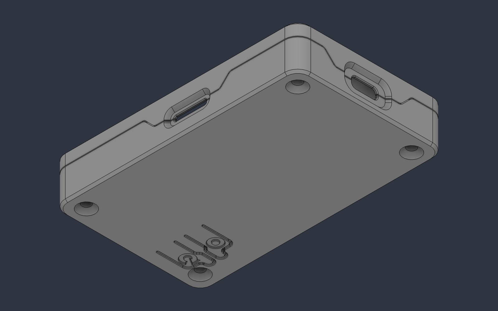
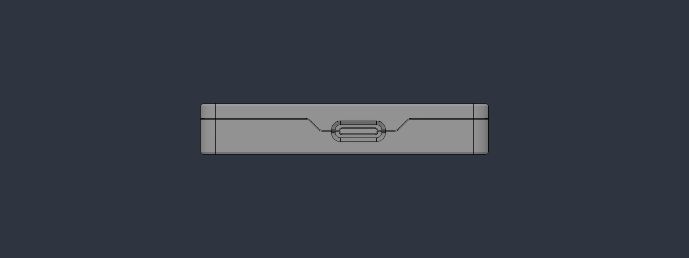
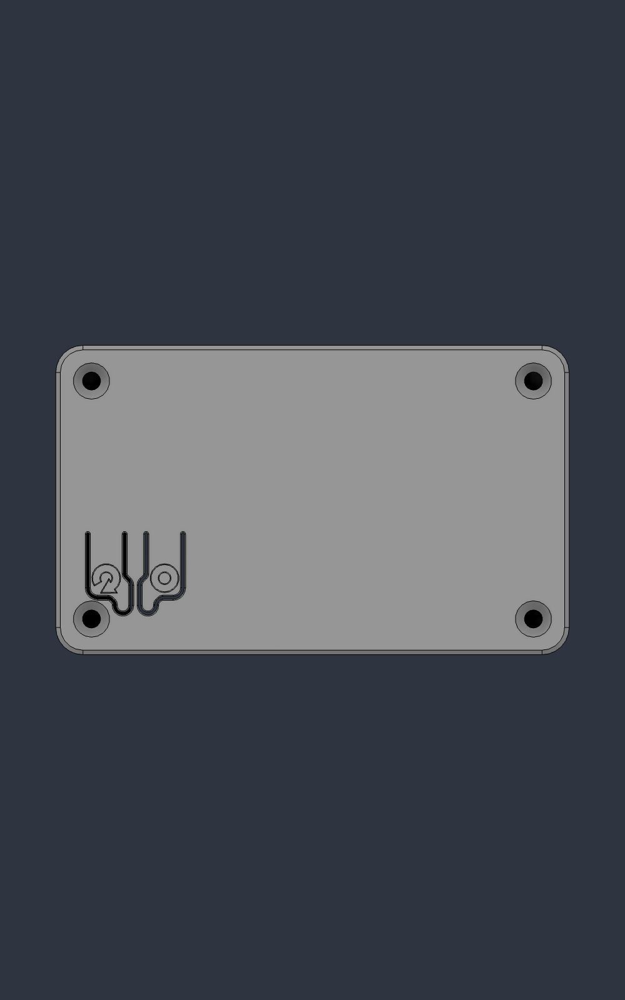

# Housing v3: microSD slot and RESET / BOOT buttons

Housing v2 with two things opened up: the **microSD card** slot on the long side, and **RESET** and
**BOOT** buttons printed into the floor of the base. Same outside size, same four screws and inserts,
same light pipe. Printed and test-fitted on a USB-C board; this is a released design.

The step-by-step build (buying, printing, inserts, assembly) is the [build guide](../../docs/BUILD.md);
the parts list as a spreadsheet is [`BOM.csv`](../../BOM.csv).

| File | Part | Qty | Print |
|---|---|---|---|
| `CYD_Case_v3_Base.stl` | Base — board drops in USB-C end first; RESET / BOOT flexures in the floor | 1 | open side **up**, no supports |
| `CYD_Case_v3_Lid.stl` | Lid — display window, insert bosses, USB-C and microSD tongues | 1 | face **down** on the bed, no supports |
| `CYD_Case_v3_LightPipe.stl` | Light pipe for the light sensor — unchanged from v2 | 1 | **clear** filament, flange down, 100 % infill |

Outer size 54.6 × 90.6 × 16.1 mm, the same as v2. STL for printing, STEP if you want to change something.

## What's new

**microSD slot.** The card slot is opened on the long side with the same split tongue as the USB-C
port, so both halves still print flat with no supports. The slot is 11.6 × 1.6 mm with a lead-in, and
a funnel guides the card in. Push the card in until it clicks; push again and it stands about 2.5 mm
proud, enough to pinch.

**RESET and BOOT buttons.** Two flexure tongues in the floor of the base, each with a small nib that
presses the board's switch from below. They are marked on the underside. RESET is the one nearer the
corner screw.

- **RESET** restarts the board.
- **BOOT**: hold it while you press RESET (or while you plug in the cable) to put the board into
  download mode, for a board that won't take a flash on its own.
- Each tongue is 1.2 mm thick, the same as housing v4, for a firm press that won't trigger by accident.

## Print settings that matter

Everything in v2's settings applies (PETG, 0.2 mm layers, 3–4 perimeters, no supports), plus:

- **Turn on elephant-foot compensation** for the base. The buttons are cut free by 0.6 mm slots that
  start on the bed; a squashed first layer can bridge them. After printing, check both buttons flex
  freely. If one is stuck, run a knife along its slot.
- **Try a card early.** Print the base and slide a microSD card into its half of the slot. If it
  catches, sand the lead-in lightly before printing the lid.

## Hardware

The same as v2: four M3 × 14 mm flat-head screws (DIN 7991) into four M3 × 4 mm heat-set inserts.
Full fastener sheet with a section drawing: [`Fastener_Spec.pdf`](../v2/Fastener_Spec.pdf).

## Assembly

As in the [build guide](../../docs/BUILD.md). Two things to know for v3:

1. Seat the board USB-C end first, then let the microSD end drop. The card socket lines up with the
   lower half of the slot.
2. Fit the card after the case is closed. Taking the lid off is never needed to change it.

## What's covered / open

- Open: USB-C, microSD, RESET, BOOT, light sensor (through the pipe), display, touch.
- Covered: micro-USB, the JST headers, the speaker connector. Openings for those are planned for a later housing.

## Modifying

`*.step` files are exact geometry, in the same coordinates as v2. The button tongue thickness is a
single parameter in the source model, `FLEX_T` (1.2 mm).
